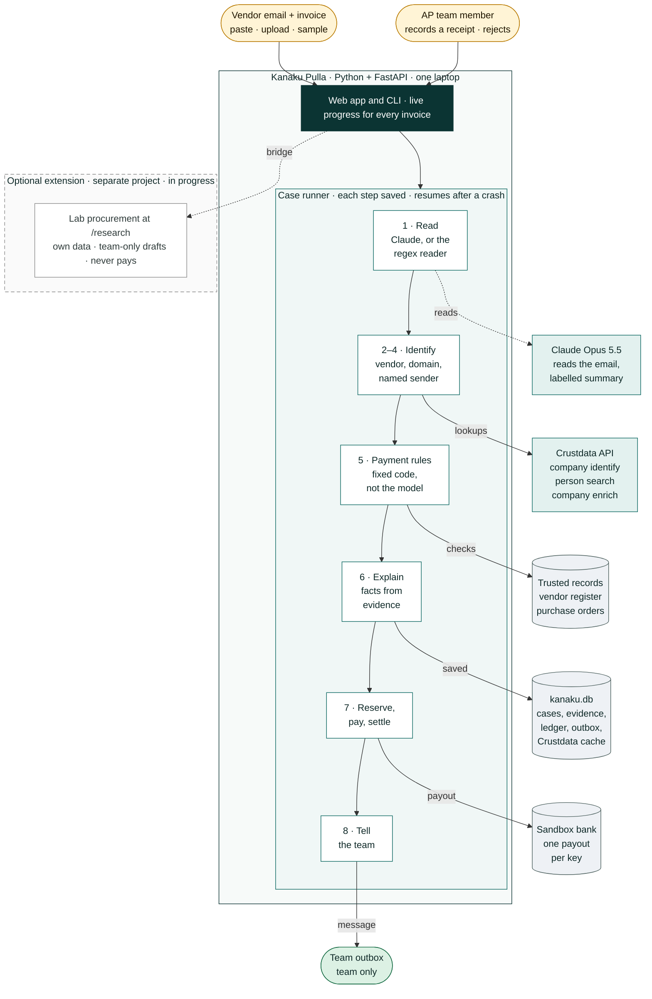
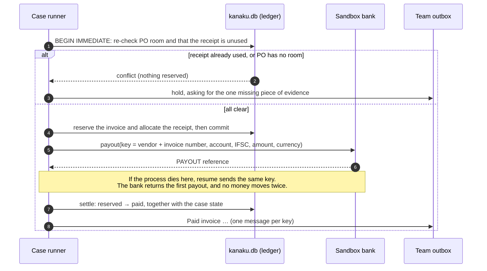
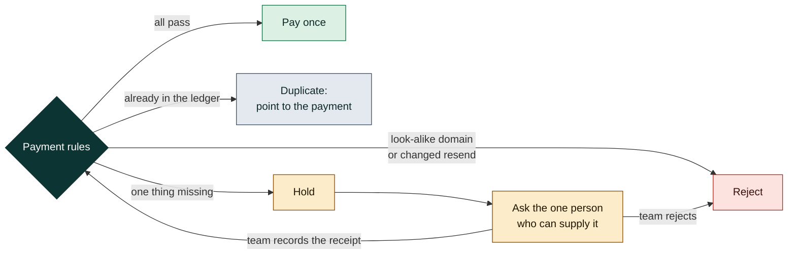

# How Kanaku Pulla is built

Kanaku Pulla is a Python app that runs on one laptop. A vendor email goes in. It is checked against our own records
and Crustdata. Then fixed rules pay it exactly once, hold it for one missing piece of evidence, or reject it.

## 1. System overview

Every step writes its result to `kanaku.db` before the next starts, which is how a crashed run resumes. Crustdata
answers are cached for 24 hours and retried on rate limits and timeouts.

## 2. Paying exactly once

## 3. Where a person comes in

There is no "approve anyway". A hold clears only when the specific missing evidence arrives, and then every rule
runs again.

## What runs where

| Part | What it is | State |
|---|---|---|
| Web app and CLI | FastAPI, server-rendered pages; `python -m kanaku_pulla` | none of its own |
| Case runner | 8 steps, each saved before the next; a background thread per invoice | `kanaku.db`: `cases`, `events` |
| Model | Claude Opus 5.5, used only to read the email and add a labelled summary. Without a key a regex reader takes over | none |
| Crustdata | company identify (domain and name), person search, company enrich for new vendors | `kanaku.db`: `api_cache` (24 h) |
| Decision | fixed rules in `kanaku_pulla/policy.py` | `kanaku.db`: `evidence` |
| Trusted records | vendor register, purchase orders, team receipts | `data/*.json`, `kanaku.db`: `receipts` |
| Money | ledger reservation, then the sandbox bank, then settle | `kanaku.db`: `payments`, `receipt_allocations`; `sandbox_bank.db` |
| People | team-only outbox; receipts recorded through the web form or CLI | `kanaku.db`: `outbox` |
