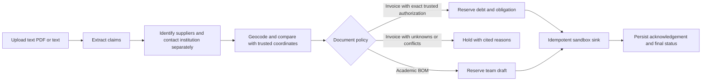

# Munim Core: corporate and academic diligence

A modular Python/FastAPI extension included in the Kanaku Pulla repository under `research_core/`. The site mounts it through a small bridge at **`/research`**, using Kanaku Pulla's navigation and styles. Research data stays separate; the AP policy and payment code remain the payment authority. This copy supersedes the earlier sibling `munim_core` prototype.

## What works

| Input | Completed service |
| --- | --- |
| Corporate invoice | Extract claims, resolve supplier/contact candidates, compare precise geocodes with trusted reference coordinates, require a trusted invoice-specific PO/receipt authorization, then record one sandbox payout |
| Academic bill of materials | Check each supplier separately from the author/institution, flag uncertain or changed affiliations and address discrepancies, then create one team-only materials/code request draft with reasons for review |

Both paths produce a persisted case, evidence with sources and dates, an audit page, and a recoverable action record. Corporate unknowns stop automatic payment. Academic unknowns appear in the completed review draft; the draft does not approve procurement.

The default verification provider is **synthetic demo data**, visibly labeled throughout the audit. Live Crustdata/Google adapters are contract-tested with mocked responses. Document reading is separate: in the host, unstructured documents use the existing Gemini/OpenRouter/Claude router and configured credentials; labelled documents need no model call.

## Corrections to the supplied proposal

1. **Geocoding is not shell-company detection.** Latitude/longitude, a building type or a PO box cannot prove fraud. `premise`/`subpremise` do not classify commercial legitimacy. Google explicitly cautions that even a rooftop geocode does not necessarily establish address existence. This implementation compares precise coordinates against an operator-supplied reference and returns a discrepancy for review. Approximate or partial matches remain unverified. [Geocoding responses](https://developers.google.com/maps/documentation/geocoding/guides-v3/requests-geocoding), [address validation versus geocoding](https://developers.google.com/maps/architecture/geocoding-address-validation).
2. **Profile data is not authentication.** A dataset can list current/past roles; it does not prove who sent a document, present authority, or fraudulent intent. A missing profile means unverified. An author's changed affiliation is a contact-routing lead for the team, not evidence against the reagent supplier.
3. **Use the current Crustdata schema.** Person Search takes a filter object and returns `profiles`, not the supplied example's flat filter list and `persons`. Company Identify returns candidate matches, not a legal-registry verdict. [Person Search](https://docs.crustdata.com/api-reference/person-apis/search-people-using-filters-and-sorting), [Company Identify](https://docs.crustdata.com/api-reference/company-apis/identify-a-company-from-name-domain-id-or-profile-url).
4. **An action-log primary key alone is insufficient.** The receiver must enforce the same idempotency key. Here, a separate SQLite sandbox sink atomically records each effect and rejects conflicting payloads. Recovery retries that key. External email delivery is not claimed to be exactly once; no external email is sent.
5. **A bill of materials is not an invoice.** The academic path cannot create a payout. Real purchasing still requires an approved order, delivery evidence and the AP policy.

## Run locally (PowerShell)

The current Kanaku Pulla installation includes the extension. Open `http://127.0.0.1:8000/research` for Lab procurement. Its Review, Evidence, Location, Team draft and Activity tabs use the existing site shell. This embedded installation cannot make Core payments. See [INTEGRATION.md](INTEGRATION.md) to reproduce the integration and configure live sources.

The main application's requirements install this module automatically. For a separate standalone environment:

```powershell
cd G:\contextcon\munim\research_core
python -m venv .venv
.\.venv\Scripts\python.exe -m pip install -e '.[llm,test]'
```

Run the standalone demo using explicit synthetic authorizations:

```powershell
.\.venv\Scripts\python.exe -m diligence_core.cli --data-dir runtime/demo --demo-trust run diligence_core/fixtures/corporate_invoice.txt
.\.venv\Scripts\python.exe -m diligence_core.cli --data-dir runtime/demo --demo-trust run diligence_core/fixtures/academic_bom.txt
.\.venv\Scripts\python.exe -m diligence_core.cli --data-dir runtime/demo --demo-trust run diligence_core/fixtures/academic_address_discrepancy.txt
.\.venv\Scripts\python.exe -m diligence_core.cli --data-dir runtime/demo --demo-trust effects
```

Start the web app on a separate port:

```powershell
$env:CORE_MODE = 'demo'
$env:CORE_DATA_DIR = 'runtime/web-demo'
$env:CORE_AUTHORIZATIONS = 'diligence_core/fixtures/authorizations.json'
$env:CORE_REGISTRY = 'diligence_core/fixtures/registered_locations.json'
.\.venv\Scripts\python.exe -m uvicorn diligence_core.api:create_app --factory --host 127.0.0.1 --port 8011
```

Open `http://127.0.0.1:8011/` for upload/paste and `http://127.0.0.1:8011/docs` for the API. Demo source verification and labelled extraction work offline. Unstructured documents use a configured external reader. The API is an unauthenticated **local sandbox**, not a public deployment.

For live checks, set `CORE_MODE=live`, `CRUSTDATA_API_KEY`, and `GOOGLE_MAPS_API_KEY`. Configure separate trusted authorization/location JSON files; do not reuse synthetic trust files as live evidence. No credentials are read from the other app or its plugins. Environment variables are read directly; `.env.example` is a template, not an automatically loaded file.

**Inside Kanaku Pulla:** research reuses `KANAKU_LLM`, the existing model choices, `OPENROUTER_API_KEY` or the git-ignored `open-router-key.txt`, and configured Gemini/Claude fallbacks. No separate Anthropic key or `CORE_LLM_MODEL` is required. Research uses a narrower academic schema that has no payment fields. Crustdata resolves and checks entities after extraction; it is not substituted for a document reader.

**Standalone:** use `OPENROUTER_API_KEY` plus `CORE_OPENROUTER_MODEL` (or `KANAKU_OPENROUTER_MODEL`). Optional Claude support accepts `ANTHROPIC_API_KEY` plus `CORE_LLM_MODEL`. The host uses its existing bounded retry/fallback router; the minimal standalone OpenRouter adapter makes one timed request and holds on failure. Both validate response schemas and verbatim source quotes.

Labelled text works offline; see the fixture format or download `/research/template`. Text PDFs are parsed with page markers. Encrypted, unreadable, oversized and scanned/image-only PDFs return an explicit error; OCR is not implemented. Uploaded documents are untrusted input, never instructions. Missing websites remain unverified; the reader may not invent them.

## State and invariants



- Saved steps: `extract -> identify -> geocode -> decide -> act -> done`. Each completed step persists its state. Unexpected errors retain the step and become `ERROR`; `resume` retries unfinished cases.
- Exact input reupload returns its case. Supplier aliases are merged only through the provider's canonical company ID, not fuzzy names. People use canonical person IDs after unambiguous profile/institution matching; ambiguous results stay separate/unverified. This does not establish legal-entity identity beyond the provider's record granularity.
- Invoice effect key: canonical company ID + conservatively normalized invoice number. Amount/account/currency/IFSC belong to immutable payload comparisons, not the key.
- A unique approved obligation is allocated in the same `BEGIN IMMEDIATE` transaction as its action reservation, preventing two different invoices from spending that authorization.
- Corporate authorization is exact-invoice and exact-amount. General PO partial allocations and multi-receipt matching remain in the existing AP application; this extension does not reimplement them.
- Draft effect key: paper reference + request purpose + configured team recipient. A changed immutable draft payload under that key becomes a conflict rather than another draft. Incremental request/version workflows are not implemented.
- The sink commits the effect in its own database before the workflow acknowledges it. A crash in between leaves `pending`; retry returns the same effect reference.
- Stable idempotency is conditional on preserving both databases and stable business identities. It is not a claim about arbitrary external banks or SMTP providers.
- `resume` processes interrupted/error cases. Failed document reads can be retried on the same case, including old Anthropic-only errors, provided extraction never completed and no action exists. Reuploading the same failed input also retries reading. A transaction enforces that boundary; completed drafts, payment holds, completed payments and cases from another mode cannot be reopened this way. Prior events remain in the audit.

## Geodesic data

Coordinates are validated as latitude `[-90, 90]`, longitude `[-180, 180]`. Distances use GeographicLib's **WGS84 ellipsoidal geodesic**, in meters; they are not road distances. An operator-supplied tolerance controls discrepancy review.

The audit preserves the input address, result coordinates, precision, partial-match flag, provider source/retrieval date, reference coordinates/source/observation date, calculated distance, threshold and limitations. Public data observation time is explicitly `unknown` when the provider does not supply it. The synthetic reference locations are not real company addresses.

## APIs and requests

Crustdata requests use `Authorization: Bearer ...` and `x-api-version: 2025-11-01`.

```json
POST /company/identify
{"domains": ["supplier.example.org"], "exact_match": true}
```

```json
POST /person/search
{
  "filters": {"field": "basic_profile.name", "type": "=", "value": "Person Name"},
  "fields": ["basic_profile", "experience.employment_details", "social_handles"],
  "limit": 5
}
```

Name lookup yields candidates; code compares exact names, optional profile URLs, and current/past canonical company IDs locally. It does not assume the first search result is the person. A truncated candidate page remains ambiguous. The supplier's company ID is not reused as the paper author's institution ID.

Google geocoding uses the official fixed endpoint with `address` and API key parameters. It does not implement commercial/residential classification. The transport has SQLite-coordinated per-endpoint pacing, bounded retries, timeout handling, `Retry-After` support and a one-hour cache. API keys are excluded from stored request provenance; cache isolation includes a secret hash. A long retry delay becomes an explicit unavailable result rather than a tight retry loop.

## Tests and demo

```powershell
.\.venv\Scripts\python.exe -m pytest -q -p no:cacheprovider
```

See [DEMO.md](DEMO.md) for crash/replay commands, [INTEGRATION.md](INTEGRATION.md) for merging into the current app, and [CORE_EXPLAINED.md](CORE_EXPLAINED.md) for team-facing progress.

The extension suite covers both actual process-crash paths, concurrent sink writes, obligation reuse, aliases, changed payment details, missing authorization, ambiguous identity, geodesic correctness, approximate coordinates, PDF uploads, malformed/scanned PDFs, citation grounding, timeouts, retry limits, API contract shapes and host UI integration. The host suite adds OpenRouter key-file reuse, safe reading retries, missing-domain handling, credential sharing and ledger-backed buying history. Tests use mocked or synthetic providers. For an explicit live reader check with fictional input, run `python scripts/verify_research_reader.py` from the repository root; it writes a local draft in isolated smoke-test storage.
